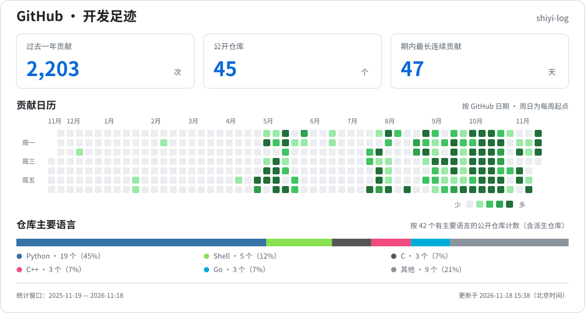

# 十一 · shiyi-log

**独立开发者，关注自托管服务、云端运维与开发效率工具。**

[GitHub 主页](https://github.com/shiyi-log) · [全部仓库](https://github.com/shiyi-log?tab=repositories)

## 关于我

我主要开发后端服务与管理界面，关注如何让基础设施运维和软件发布流程更简单、更可靠。项目通常从实际问题出发，并尽量做到易于测试、部署和维护。

## 项目展示

| 项目 | 简介 | 技术栈 |
| --- | --- | --- |
| [fuwu](https://github.com/shiyi-log/fuwu) | 面向多个软件项目的发行管理服务，支持制品校验、发行渠道、回滚、权限控制和审计记录。 | Python、Django、Vue 3 |
| [X-ray](https://github.com/shiyi-log/X-ray) | 独立的 X-ray 管理平台。 | Python |
| [duankou](https://github.com/shiyi-log/duankou) | 本地端口登记与监控工具。 | Python |
| [crypto-quant-terminal](https://github.com/shiyi-log/crypto-quant-terminal) | 加密资产量化研究终端，集成行情数据、Vue 界面与 Freqtrade。 | Python、Vue、PostgreSQL |

## 常用技术

## GitHub 统计

<picture>
  <source media="(prefers-color-scheme: dark)" srcset="./assets/github-stats-dark.svg" />
  <source media="(prefers-color-scheme: light)" srcset="./assets/github-stats-light.svg" />
  
</picture>

